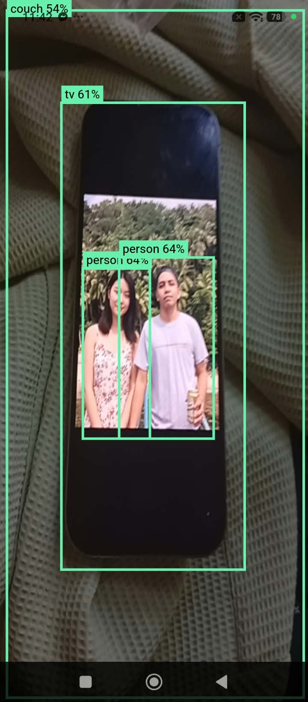

# Kenetic Object Detector

A Flutter app that detects objects in real time through the device camera and draws labeled bounding boxes over them. Inference runs fully on-device using [LiteRT](https://ai.google.dev/edge/litert) (formerly TensorFlow Lite) via the [`flutter_litert`](https://pub.dev/packages/flutter_litert) package, so no internet connection or server is needed.

> This project integrates a **pretrained** detection model into a Flutter app. The model itself was not trained by me; see [Model and credits](#model-and-credits).

## Screenshots

<!-- Replace these with your own screenshots or a demo GIF, e.g. put files in a docs/ folder -->
| Splash | Detection |
| --- | --- |
|  |  |

## Features

- Live camera preview with real-time object detection
- Bounding boxes with class label and confidence score
- Pinch-to-zoom on the camera preview
- Splash screen on launch
- 100% on-device inference (no data leaves the phone)

## Tech stack

| Part | Choice |
| --- | --- |
| Framework | Flutter (Dart) |
| Camera | [`camera`](https://pub.dev/packages/camera) |
| Inference | [`flutter_litert`](https://pub.dev/packages/flutter_litert) |
| Model | COCO-trained detection model in `.tflite` format (EfficientDet-Lite0 recommended) |
| Platform | Android (minSdk 24) |

## How it works

```
Camera frame (YUV420)
      |
      v
Rotate + resize to model input size, convert to RGB
      |
      v
LiteRT Interpreter  -->  boxes, classes, scores, count
      |
      v
Filter by confidence threshold, map class IDs to labels
      |
      v
CustomPaint overlay draws boxes on top of the preview
```

## Technical highlights

- **Manual YUV420 to RGB conversion.** Camera frames arrive in YUV420 and are rotated according to the sensor orientation, resized and converted to RGB in a single pass, without extra image libraries.
- **Frame dropping.** Frames that arrive while a previous one is still being processed are skipped, which keeps the preview smooth.
- **Model-driven setup.** The input size and output tensor layout are read from the model at startup instead of being hardcoded, so different detection models can be swapped in with few changes.
- **Efficient overlay.** Boxes are drawn with a `CustomPainter` that repaints through a `ValueNotifier`, so only the overlay redraws, not the whole page.

## Project structure

```
lib/
├── main.dart                       # App entry point
├── detection.dart                  # Detection model (box, label, score)
├── pages/
│   ├── splash_page.dart            # Splash screen
│   └── camera_page.dart            # Camera preview, zoom, detection loop
├── services/
│   └── detector_service.dart       # Loads the model, runs inference
└── widgets/
    └── custom_box_painter.dart            # CustomBoxPainter: draws the boxes
assets/
├── detect.tflite                   # Detection model
└── labelmap.txt                    # Class names, one per line
```

## Getting started

### Prerequisites

- Flutter SDK (stable channel)
- Android Studio or VS Code with the Flutter extension
- A physical Android device (recommended; the camera stream is unreliable on most emulators)

### 1. Install dependencies

```bash
flutter pub get
```

### 2. Add the model and labels

Place these two files in the `assets/` folder (if they are not already included in the repository):

- `detect.tflite`: a detection model with a uint8 input
- `labelmap.txt`: the matching class names, one per line

Suggested models:

- **EfficientDet-Lite0** (recommended): available in the [`litert-community/efficientdet`](https://huggingface.co/litert-community/efficientdet) repository on Hugging Face. Uses a 320x320 input.
- **COCO SSD MobileNet v1 (quantized)**: older and less accurate, but simple. Uses a 300x300 input.

Make sure the assets are declared in `pubspec.yaml`:

```yaml
flutter:
  assets:
    - assets/detect.tflite
    - assets/labelmap.txt
```

### 3. Android configuration

In `android/app/build.gradle.kts`, make sure the minimum SDK is at least 24:

```kotlin
defaultConfig {
    minSdk = maxOf(flutter.minSdkVersion, 24)
}
```

In `android/app/src/main/AndroidManifest.xml`, make sure the camera permission is declared:

```xml
<uses-permission android:name="android.permission.CAMERA"/>
```

### 4. Run

```bash
flutter run
```

Grant the camera permission when prompted.

## Configuration

Settings live at the top of `lib/services/detector_service.dart`:

| Setting | Default | Description |
| --- | --- | --- |
| `modelAsset` | `assets/detect.tflite` | Path to the model file |
| `labelsAsset` | `assets/labelmap.txt` | Path to the label file |
| `labelOffset` | `1` | Added to the class ID before the label lookup |
| `threshold` | `0.5` | Minimum confidence for a detection to be shown |

Camera resolution is set in `lib/pages/camera_page.dart` (`ResolutionPreset.medium`). A lower resolution is cheaper to process; the model resizes frames anyway, so medium is plenty.

## Troubleshooting

**Labels are off by one (e.g. a person is labeled "bicycle")**
Change `labelOffset` between `0` and `1`. Models with a `???` placeholder on the first line of their label file need `1`; others usually need `0`.

**"Unexpected model outputs" error at startup**
Look at the `Output 0: ...` lines printed in the debug console and compare them with what your model should return (boxes `[1, N, 4]`, plus classes, scores and count). Models that don't follow the standard detection output format need custom decoding.

**Boxes are rotated or in the wrong place**
The rotation logic uses the camera's `sensorOrientation`. Boxes are mapped for portrait mode with the back camera. The front camera additionally needs its x-coordinates mirrored.

**Preview stutters or detection lags**
Inference currently runs on the main isolate. Try a lower camera resolution or a smaller model, or move detection into a separate isolate.

**Build fails on minSdk**
Set `minSdk` to 24 or higher as shown above, then run `flutter clean` and `flutter run`.

**`Detection` or `BoxPainter` name conflicts**
`flutter_litert` exports its own `Detection` class, so `detector_service.dart` imports it with `hide Detection`. Flutter itself has a `BoxPainter` class, which is why the overlay class is named `DetectionPainter`.

## Possible improvements

- Run inference in a background isolate
- Hardware acceleration through LiteRT delegates
- Front camera support with mirroring
- Non-maximum suppression and tracking to reduce flicker between frames
- Custom-trained model for your own object classes
- iOS support

## Model and credits

- **Model:** The detection model is a pretrained COCO model (EfficientDet-Lite0 or SSD MobileNet, depending on the file in `assets/`). EfficientDet-Lite0 is distributed through the [`litert-community/efficientdet`](https://huggingface.co/litert-community/efficientdet) repository on Hugging Face under the Apache 2.0 license. Check the license of the exact model file you use, and keep its attribution if you redistribute it.
- **Libraries:** [LiteRT](https://ai.google.dev/edge/litert) by Google, [`flutter_litert`](https://pub.dev/packages/flutter_litert) and [`camera`](https://pub.dev/packages/camera).
- **Research and data:** [EfficientDet](https://arxiv.org/abs/1911.09070) and the COCO dataset.

## License

This project's source code is released under the MIT License (add a `LICENSE` file to the repository). The model in `assets/` keeps its own license, described above.
